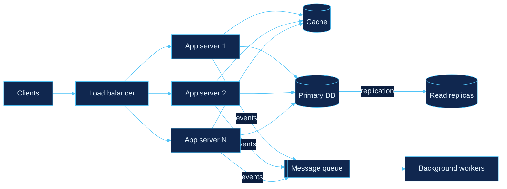
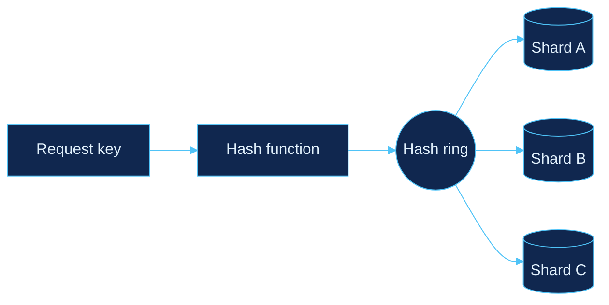
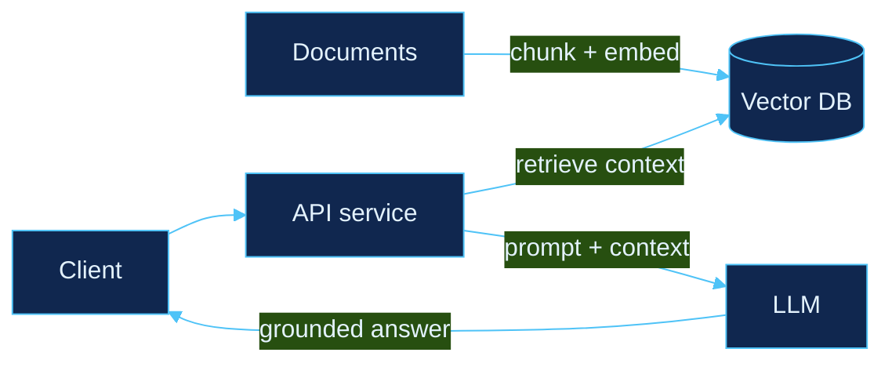

<!-- ============================================================
     TEMPLATE 4 · BLUEPRINT ARCHITECT  (system-design showcase)
     Mermaid diagrams render natively on GitHub.
     ============================================================ -->

  

  

## 📐 Spec sheet

| Field | Value |
|:--|:--|
| **Engineer** | Aditya Goyal |
| **Program** | B.Tech Electronics & Communication Engineering, BIT Mesra (2023–2027) |
| **Focus** | Backend + AI, system design, distributed systems |
| **Strengths** | Data structures & algorithms, low-level design, full-stack web, data analytics |
| **Status** | 🟢 Open to SDE internships and full-time roles |

I care about designs that are simple to reason about, measurable under load and honest about their trade-offs. Coming from ECE, I think about latency, bandwidth and noise by default, and I bring that lens to how services talk to each other.

## 🧰 Materials

  

  
  
  
  
  

## 🗂️ Architecture notebook

How I think about systems: the building blocks I design with and keep studying.

### Sheet 01 · A scalable web service

### Sheet 02 · Partitioning data with consistent hashing

### Sheet 03 · A backend with AI inside (RAG)

## 📏 On the drafting table

What I already use, and what I'm working through for distributed systems.

- [x] Data structures & algorithms in C++
- [x] Low-level design: OOP, SOLID, design patterns
- [x] REST APIs and real-time communication (WebSockets)
- [x] Relational, document and vector databases
- [x] LLM apps with LangChain, RAG and embeddings
- [ ] Caching strategies and cache invalidation (Redis)
- [ ] Message queues and event-driven architecture (Kafka)
- [ ] Sharding, replication and consistent hashing
- [ ] CAP theorem, consistency models and consensus (Raft)
- [ ] Containerisation and deployment (Docker)
- [ ] AI agents, tool use and LLM evaluation

## 🧮 Load tests

  

  
  
  

  
  

  

  

  

## 🔌 Interfaces

  
  
  
  

  

